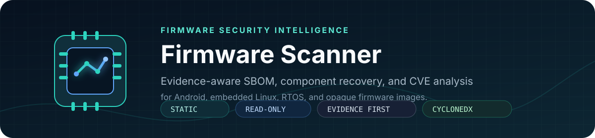
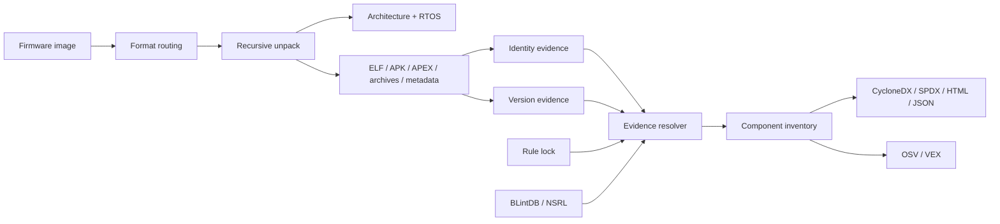

<p align="center">
  
</p>

<div align="center">

**Static-first firmware SBOM, component recovery, and vulnerability analysis.**

[](https://github.com/abcde55555/firmware_scanner/actions/workflows/ci.yml)
[](https://github.com/abcde55555/firmware_scanner/releases)
[](https://www.python.org/)
[](LICENSE)
[](https://cyclonedx.org/)
[](https://spdx.dev/)

[Quick start](#quick-start) ·
[How it works](#how-it-works) ·
[Version evidence](#version-evidence) ·
[Reference databases](#reference-databases) ·
[Results](#reference-evaluations) ·
[Documentation](#documentation)

</div>

Firmware Scanner inspects firmware without executing binaries from the target.
It recursively unpacks images, identifies architectures and RTOS families,
inventories components and versions, records evidence, and exports CycloneDX,
SPDX, HTML, JSON, and vulnerability reports.

> [!NOTE]
> Use Firmware Scanner only with firmware and artifacts you are authorized to
> inspect. The tool performs read-only static analysis and does not emulate or
> run target binaries.

## Why Firmware Scanner?

Firmware rarely includes source manifests, lockfiles, or a reliable package
database. File names alone are not enough for a defensible SBOM. Firmware
Scanner combines independent observations and keeps each version claim scoped
to the evidence that supports it.

| Capability | What it does |
|---|---|
| **Firmware-aware unpacking** | Handles Android, embedded Linux, RTOS images, U-Boot/FIT, archives, compressed containers, and nested artifacts |
| **Static component recovery** | Uses ELF symbols, imports, version APIs, read-only objects, source paths, language metadata, binary signatures, and package archives |
| **Evidence-aware versions** | Distinguishes exact releases, estimates, source revisions, parent-package versions, platform builds, conflicts, and unknown |
| **Reference database support** | Integrates pinned BLintDB identity candidates and NIST NSRL exact-file evidence without overwriting target versions |
| **Reproducible output** | Presents CycloneDX 1.6, SPDX 3.0.1, raw JSON, HTML, VEX, input hashes, rule lock hashes, and database provenance |
| **Extensible analysis** | Adds firmware formats, extractors, RTOS plugins, external rule packs, and optional radare2/Ghidra analysis |

## At a Glance

| Inputs and formats | Analysis | Outputs |
|---|---|---|
| Raw images, ELF, Intel HEX, S-Record | Architecture and endianness detection | CycloneDX 1.6 |
| Android system, `super.img`, APEX, APK, OTA | RTOS and platform identification | SPDX 3.0.1 |
| Allwinner IMAGEWTY, FIT/U-Boot, ESP-IDF | Component and dependency inventory | Standalone HTML |
| Compressed/archive containers | Evidence-scoped version resolution | Raw JSON and VEX |
| Embedded filesystems and nested files | OSV vulnerability matching | Operator dashboard and scan logs |

## Quick Start

### Install from source

```bash
git clone https://github.com/abcde55555/firmware_scanner.git
cd firmware_scanner
python3 -m pip install -e .
```

For Android images, include the Android extra:

```bash
python3 -m pip install -e ".[android]"
```

Verify the installation:

```bash
firmware-scanner --help
firmware-scanner check-deps
```

### Generate an SBOM

```bash
firmware-scanner analyze firmware.img -f all -o reports/
```

The output directory contains CycloneDX, SPDX, HTML, and raw JSON reports.
Choose a single format when integrating with another pipeline:

```bash
firmware-scanner analyze firmware.img -f sbom -o firmware.cdx.json
firmware-scanner analyze firmware.img -f spdx -o firmware.spdx.json
```

### Inspect or unpack before analysis

```bash
# Architecture, hashes, and likely RTOS
firmware-scanner detect firmware.img -v

# Extract detected top-level sections
firmware-scanner unpack firmware.img -o unpacked/
```

### Attach reference databases

```bash
firmware-scanner analyze system.img -f all -o reports/ \
  --blint-db /path/to/blint.db \
  --nsrl-db /path/to/android_minimal.db
```

Validate database release, size, SHA-256, schema, and production query paths:

```bash
firmware-scanner database-audit \
  --blint-db /path/to/blint.db \
  --nsrl-db /path/to/android_minimal.db \
  --verify-database-integrity \
  -o database-audit.json
```

### Scan for known vulnerabilities

```bash
# Analyze a firmware image, query OSV, and write a VEX-enabled SBOM
firmware-scanner vuln-scan firmware.img -f vex -o firmware.vex.cdx.json

# Reuse an existing CycloneDX or SPDX SBOM
firmware-scanner vuln-scan firmware.cdx.json -f all -o vulnerability-reports/
```

Vulnerability lookup uses OSV and a local 24-hour cache. Exact upstream
queries are issued only for compatible, non-conflicting versions. Source
revision, parent-package, and platform-build estimates remain non-exact.

## How It Works



The analysis pipeline is:

1. Load the image and compute content hashes.
2. Detect and recursively unpack supported containers.
3. Identify CPU architecture, endianness, and RTOS/platform family.
4. Recover component identity from symbols, signatures, metadata, source paths,
   package definitions, and optional reference databases.
5. Resolve versions with the strongest available evidence and explicit
   abstention when evidence conflicts or is incomplete.
6. Deduplicate findings while preserving locations and provenance.
7. Generate standards-based reports and machine-readable operator artifacts.

## Version Evidence

“Version present” is not the same as “version proven.” Firmware Scanner keeps
the evidence tier and resolution scope attached to each component.

| State | Meaning |
|---|---|
| `exact` | A defensible release claim supported by target or build evidence |
| `estimated-source-revision` | A source snapshot is known, but no upstream release was proven |
| `estimated-aosp-source-revision` | An official AOSP manifest project revision was selected through source-path evidence |
| `estimated-aosp-release` | A source tree declares a release, but the target binary is not independently proven |
| `estimated-platform-build` | The component belongs to an Android image build; this is not an upstream library release |
| `estimated-parent-package` | The version belongs to a containing APK, APEX, or package |
| `equivalence-class` | Multiple releases cannot be distinguished from the available evidence |
| `conflict-unresolved` | Contradictory evidence was retained and no version was selected |
| `unknown` | The component is identified but no target release can be claimed |

Outputs also retain source paths, file offsets, symbol sets, hashes, component
relationships, rule versions, and database digests where available.

## Reference Databases

External databases are treated as evidence sources, not version truth.

| Database | Used for | Important boundary |
|---|---|---|
| [BLintDB](https://github.com/AppThreat/blint-db) | Project identity candidates from symbols, imports, and fingerprints | A reference build version is not automatically the target version |
| [NIST NSRL](https://www.nist.gov/itl/csd/secure-systems-and-applications/national-software-reference-library-nsrl/nsrl-download-0) | Exact file hashes and distribution provenance | Rebuilt or OEM-modified files usually do not match, and package versions are not always upstream library versions |

Database releases are pinned through immutable manifests containing release,
size, SHA-256, schema, source URL, license, architecture, and evidence
semantics. Integrity verification is enabled by default.

## Supported Coverage

<details>
<summary><strong>Firmware and container formats</strong></summary>

- Raw `.bin`, `.img`, and `.fw`
- ELF images
- Intel HEX and Motorola S-Record
- Android system images, `super.img`, OTA, APEX, and APK
- Allwinner PhoenixSuit/LiveSuite images
- FIT and U-Boot-oriented containers
- ESP-IDF images
- Compressed images and archive containers
- CramFS, JFFS2, and related embedded filesystem extraction paths

</details>

<details>
<summary><strong>Architectures and platforms</strong></summary>

- ARM and AArch64
- MIPS
- RISC-V
- x86 and x86-64
- Xtensa
- Android and embedded Linux
- FreeRTOS, Zephyr, RT-Thread, ESP-IDF, VxWorks, ThreadX/Azure RTOS,
  NuttX, LiteOS, uC/OS, Mbed, RIOT, and Linux-family plugins

</details>

<details>
<summary><strong>Component evidence</strong></summary>

- ELF symbols and imported dependencies
- Documented version getters, structs, objects, and exported strings
- Go build metadata
- Rust crate paths, audits, and source-location candidates
- Java/Maven, Python, Node.js, and Android metadata
- Package archives and package-manager/manifest records
- Filename releases under restrictive product-version rules
- Android source paths, source manifests, build IDs, APEX, and NOTICE data
- Exact-file and symbol/import candidates from reference databases

</details>

## Reference Evaluations

These results come from authorized local firmware corpora and are not a
market-wide benchmark. They measure usable version-field coverage, not the
proportion of a whole image with independently established truth.

| Corpus | All component coverage | Native-library coverage | Exact-version rows |
|---|---:|---:|---:|
| Android 4.4 / ARM32 embedded image | **292/582, 50.17%** | **138/312, 44.23%** | 120 |
| Android 16 / x86-64 system image | **866/1,129, 76.71%** | **654/774, 84.50%** | 230 |

For the Android 4.4 evaluation, 15 newly recovered AOSP source/platform
observations matched an independently prepared calibration map:
**15 correct, 0 errors, 0 adjacent-only matches**. The calibration set informed
the rules and is not an untouched held-out set.

See:

- [v0.36 provenance release notes](docs/version-0.36-aosp-source-fallback-2026-11-20.md)
- [Version evidence research](docs/version-evidence-hardening-2026-11-20.md)
- [Database and Rust validation](docs/database-and-rust-version-validation-2026-11-20.md)

## Safety and Limits

- Firmware Scanner does not execute target binaries.
- Parsers use bounded reads and explicit coverage warnings for oversized or
  unsupported artifacts.
- Network access is required only for OSV vulnerability queries; cached results
  can be reused when available.
- A missing version is a valid result. Static evidence can be stripped, patched,
  inlined, or shared across multiple releases.
- Vendor backports may make an upstream version alone insufficient for
  vulnerability status.
- BLintDB reference versions and NSRL distribution versions do not overwrite
  target component versions.
- VEX and vulnerability results are candidates until reachability, patch state,
  vendor configuration, and applicability are independently assessed.

## CLI

| Command | Purpose |
|---|---|
| `analyze` | Full unpacking, component analysis, SBOM, and report generation |
| `detect` | Architecture, hashes, and likely RTOS detection |
| `unpack` | Extract detected top-level sections |
| `vuln-scan` | OSV matching from firmware or an existing SBOM |
| `vuln-update` | Refresh or clear the local OSV cache |
| `database-audit` | Verify external database integrity, schema, and query controls |
| `plugins` | List RTOS plugins and extractor availability |
| `check-deps` | Report optional external-tool availability |
| `init` | Create a local configuration file |

Run `firmware-scanner <command> --help` for all options.

## Extending Firmware Scanner

Custom rules and integrations are ordinary versioned inputs:

- Firmware format handlers: `src/firmware_scanner/firmware/formats/`
- RTOS analyzers: `src/firmware_scanner/rtos/plugins/`
- Component extractors: `src/firmware_scanner/extraction/extractors/`
- Signature and provenance packs: `src/firmware_scanner/data/`

Third-party plugins can register through the
`firmware_scanner.rtos_plugins` and `firmware_scanner.extractors` entry-point
groups. Every built-in JSON data pack is protected by `rules.lock.json`, so
reports can identify the exact rule release and SHA-256 used for a scan.

## Development

```bash
python3 -m pip install -e ".[dev]"
pytest
ruff check src tests
mypy src
```

Optional integrations:

```bash
python3 -m pip install -e ".[radare2]"
python3 -m pip install -e ".[ghidra]"
python3 -m pip install -e ".[full]"
```

## Documentation

- [Installation](docs/INSTALL.md)
- [Architecture and development](docs/DEVELOPMENT.md)
- [Extension guide](docs/EXTENSION_GUIDE.md)
- [Technical principles](docs/TECHNICAL_PRINCIPLES.md)
- [Product requirements](docs/PRD.md)
- [Roadmap](docs/ROADMAP.md)
- [Test report](docs/TEST_REPORT.md)
- [Versioned release notes](docs/)

## Contributing

Issues and focused pull requests are welcome. When reporting a detection
problem, include the scanner version, rule lock hash, component location,
relevant evidence, and a sanitized reproducer where possible. Do not upload
confidential firmware or unrelated proprietary artifacts to a public issue.

For security-sensitive reports, avoid public disclosure until a private
maintainer channel is agreed.

## License

Firmware Scanner is released under the [MIT License](LICENSE).
